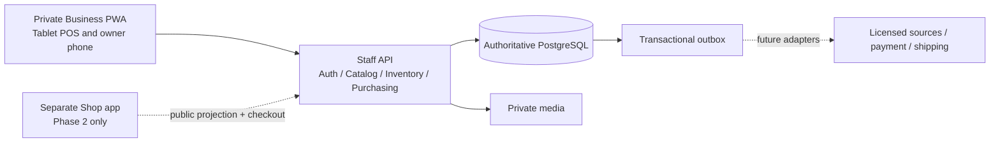
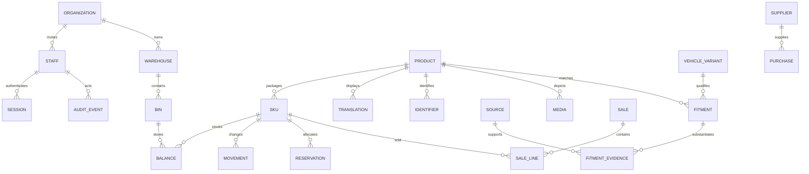

# Architecture and decisions

## Runtime boundaries

Business and the future Shop have independent frontend packages and deployment seams. There is one inventory authority, not stock synchronization between databases. Public cache/projection may become eventually consistent; checkout must reserve against PostgreSQL. External APIs must never run while inventory locks are held.

## ADR-001 — Fastify modular monolith and React SPA

The blueprint permits a justified backend equivalent to NestJS. Use strict TypeScript, React/Vite for the private PWA, and Fastify with PostgreSQL for the modular API. Internal transactions do not require SEO or server rendering. This keeps one small deployment and a browser-friendly, reload-free locale switch. Phase 2 may independently choose an SEO-capable frontend. PostgreSQL 18 is a supported current major in the official documentation checked on 2026-10-29. Fastify's published support policy tracks supported Node.js release lines. Exact dependency versions belong to the lockfile, not floating CDN scripts. Sources: [PostgreSQL locking](https://www.postgresql.org/docs/current/explicit-locking.html), [Fastify support policy](https://fastify.dev/docs/latest/Reference/LTS/).

## ADR-002 — Local, isolated execution

The owner prohibits production deployment without approval. Native PostgreSQL is available locally; Docker is not installed in the execution environment. A separate local cluster and database hold synthetic data only. Docker configuration is supplied for reproducibility but cannot be reported as tested until run. No remote hosting, paid service, or production import occurs.

## ADR-003 — Locale is session presentation state

Three dictionaries and typed keys live in a shared package. Switching updates React context and document lang/dir without remounting active forms. Authenticated preference is stored on the user's profile and is loaded at sign-in. Logout clears per-user UI state; a new employee never inherits the former employee's preference. Locale changes do not mutate business transactions. Exact identifiers remain unmodified with bdi/LTR boundaries. Approved translation coverage is a separate release gate from dictionary key completeness.

## ADR-004 — Append-only stock and corrections

Transactional updates, nonnegative checks, reserved≤on_hand checks, deterministic multi-location locking, idempotency payload fingerprints and audit protect writes. Cancel/expiry releases reservations once. Physical return intake enters quarantine; inspection controls sellability. Corrections are compensating movements with reason and approval; deletion of ledger rows is not a rollback mechanism. PostgreSQL row locks are the authority; UI arithmetic is advisory. [PostgreSQL row locks and deadlocks](https://www.postgresql.org/docs/current/explicit-locking.html).

## ADR-005 — No unlicensed catalog acquisition

The reference workbook is a template/taxonomy source only. Source discovery records do not confer rights. Unknown rights fail publication closed. Synthetic fixtures have no real compatibility claim. No protected source is scraped, no supplier credentials are fabricated, and no production compatibility is approved by AI.

## Conceptual ERD

The source-controlled SQL migrations define the actual physical model. This conceptual diagram describes required domain boundaries, not an assertion that every optional Phase 2 table is built.
